# 200 ESPADAS — Sandbox 2D Platformer

Jogo 2D de exploração, mineração e combate no estilo *Terraria*, com **200 espadas únicas**, implementado a partir do
documento **"GDD & MASTER PROMPT: SANDBOX 2D PLATFORMER"** (PDF enviado).

> **Novidade — Tiers 7 a 10 (espadas 121–200):** 4 tiers novos de pós-jogo, **20 espadas cada**, todas com **arte
> pintada pixel a pixel** (`src/06b_swordart.js`) — silhueta, guarda, cabo, pomo, gemas e efeitos de brilho próprios —
> e **um efeito de combate exclusivo** por espada (ecos do golpe, leques de lâminas, domínios, marcas que detonam,
> fendas devoradoras, singularidades, big bang). Veja a folha de contato: [`docs/img/14_espadas_novas.png`](docs/img/14_espadas_novas.png).

> **Jogar online:** **https://jk-jhon1.github.io/101spas/** — direto no navegador, sem instalar nada.
>
> **Offline:** abra o arquivo **`index.html`** num navegador moderno (Chrome, Edge, Firefox, Safari). É um único
> arquivo autocontido — sem instalação, sem internet, sem assets externos. Use teclado + mouse, um controle (gamepad) com mira analógica, ou **toque** (celular/tablet: direcional virtual e botão de ação com mira por arrasto).
>
> **Visual:** o jogo inteiro segue o estilo pixel-art do *Terraria mobile*: céu com nuvens e colinas de pixels, árvores com tronco de casca marcada, galhos e **copas redondas de folhas pontiagudas sobrepostas, com contorno escuro** (desenhadas por vizinhança em `05c_canopy.js`), tijolos chanfrados, paredes de toras, portas com almofadas, personagens de frente com dois olhos, cabelo, roupa e botas, itens e inimigos com contorno e luz vinda de cima à esquerda. Os **54 chefes** (os 4 originais e **50 novos**, cada um com visual e mecânica únicos) têm sprites próprios, pintados quadro a quadro (`05d_bosspaint.js`, `05e_bossart.js`, `05f..05j_bxart*.js`): corpo escuro e um brilho forte de uma cor para cada um (ciano, carmesim, brasa, ouro), com halo semitransparente que também soma luz no escuro, íris que acompanha o jogador, lanterna que balança e rachaduras que aparecem nas fases. A **interface** (painéis, abas, botões, balões, barra de itens na parte inferior, corações de pixel pequenos e controles de toque) é toda no **azul do Terraria mobile**. A cena é desenhada em baixa resolução (1 pixel do mundo = 1 pixel do canvas) e ampliada por um fator **inteiro** sem suavização, então os pixels ficam quadrados e nítidos em qualquer tela.

---

## ⚠️ Sobre o PDF (importante)

O PDF recebido está **truncado**: as tabelas de espadas dos **Tiers 2, 4 e 6** (espadas **021–040, 061–080 e 101–120**)
terminam logo após o cabeçalho, sem nenhuma linha. Só os Tiers **1, 3 e 5** (80 espadas) têm dados.

- As **80 espadas do PDF** foram implementadas com **nome, Dano/Vel/KB e mecânica exatamente como no documento**.
- As **40 espadas faltantes foram criadas** seguindo as regras de cada tier do próprio GDD (faixa de multiplicador de dano,
  cor e tipo de mecânica). Elas aparecem marcadas com **★** no jogo e no catálogo.
  Se você tiver o PDF completo, basta editar as linhas correspondentes em `src/11_swords.js` e rodar `node build.js`.
- As **80 espadas dos Tiers 7–10** (121–200) são **novas**: não constam no PDF. Foram criadas depois, como pós-jogo,
  com **arte pintada pixel a pixel** e **efeito de combate exclusivo por espada** (catálogo em `src/11b_swords_x.js`,
  desenho em `src/06b_swordart.js`).

| Tier | Espadas | Origem | Regra do GDD que guiou as criadas |
|---|---|---|---|
| T1 Básico `#10b981` | 001–020 | PDF | — |
| T2 Pré-Bosses `#0284c7` | 021–040 | ★ criadas | projéteis retos simples, roubo de vida baixo, repulsão massiva, fogo/gelo |
| T3 Mid-Game `#7c3aed` | 041–060 | PDF | — |
| T4 Hardmode Inicial `#d97706` | 061–080 | ★ criadas | ondas de choque no relevo, estalagmites, esporos flutuantes, aura gravitacional |
| T5 Hardmode Avançado `#dc2626` | 081–100 | PDF | — |
| T6 End-Game Mítico `#4f46e5` | 101–120 | ★ criadas | projéteis rastreadores, colapso estelar, portais de ataque, dano em tela cheia |
| **T7 Forja Estelar** `#eab308` | 121–140 | ★ **tier novo** | ecos do golpe, leques de lâminas, correntes elétricas, escudos vivos |
| **T8 Relicário do Vazio** `#db2777` | 141–160 | ★ **tier novo** | marcas que detonam, fendas devoradoras, almas perseguidoras, domínios |
| **T9 Eco Primordial** `#06b6d4` | 161–180 | ★ **tier novo** | domínios divinos, feixes de julgamento, tempo parado, órbitas de luz |
| **T10 Origem** `#f8fafc` | 181–200 | ★ **tier novo** | dano em tela cheia, colapsos cósmicos, singularidades, big bang |

Catálogo completo (com receitas): [`docs/catalogo_200_espadas.md`](docs/catalogo_200_espadas.md) e `.csv`.

---

## Capturas

| | |
|---|---|
| 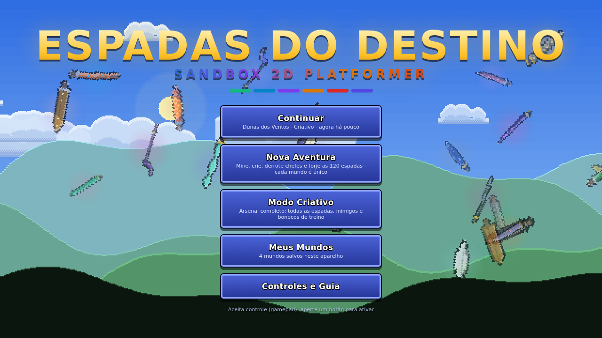 | 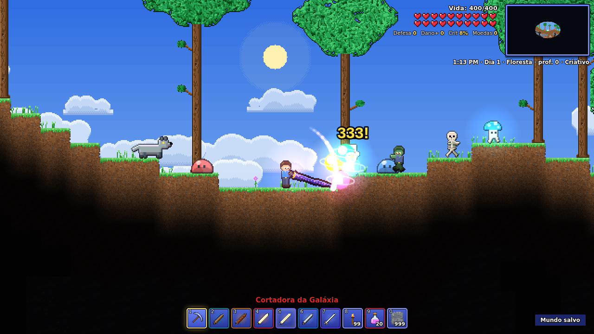 |
| 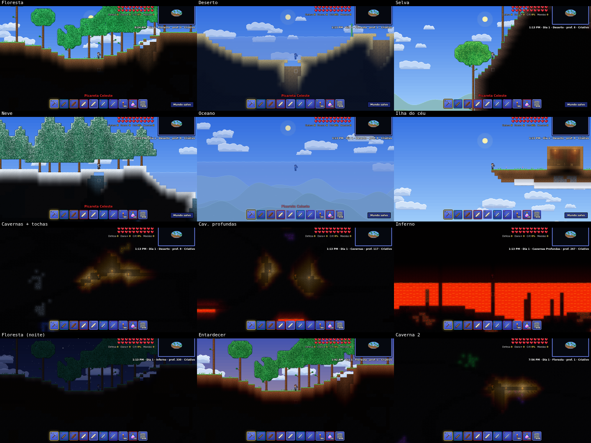 | 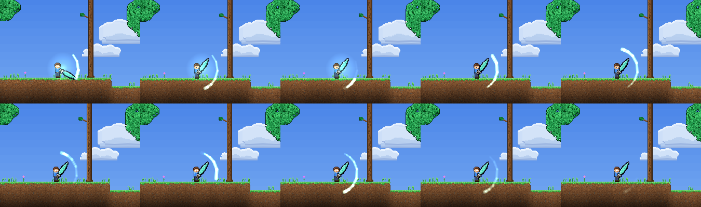 |
| 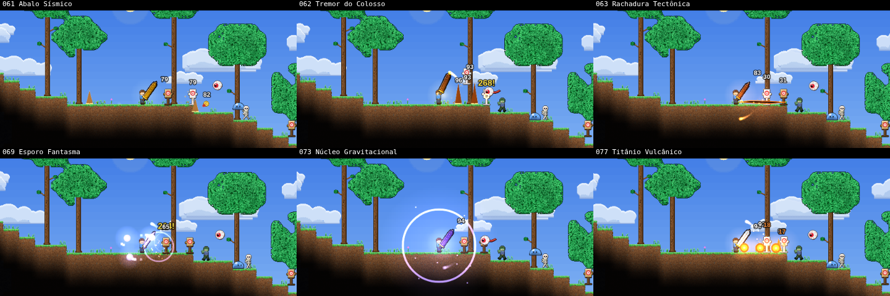 | 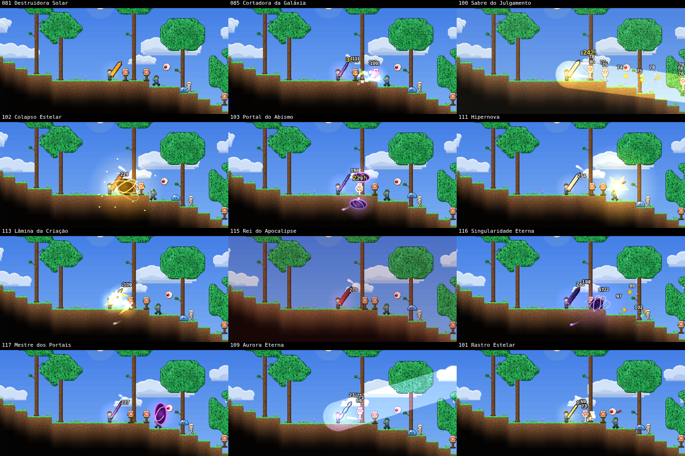 |
| 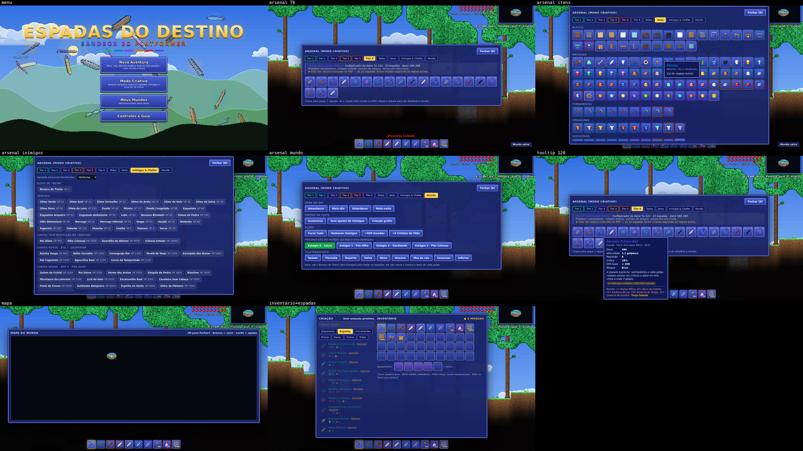 | 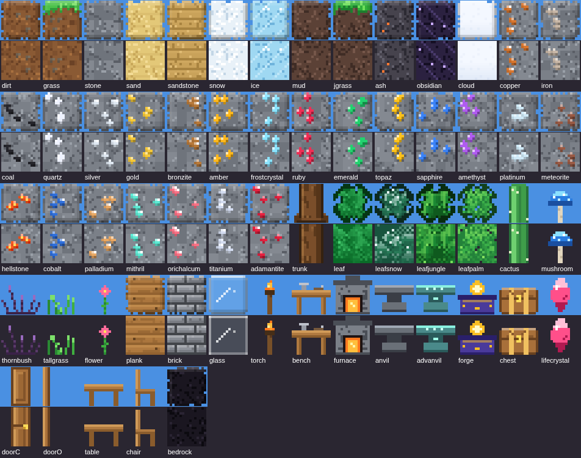 |
| 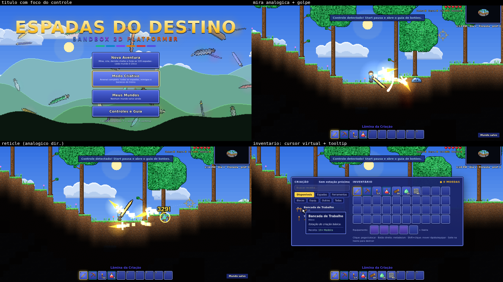 | 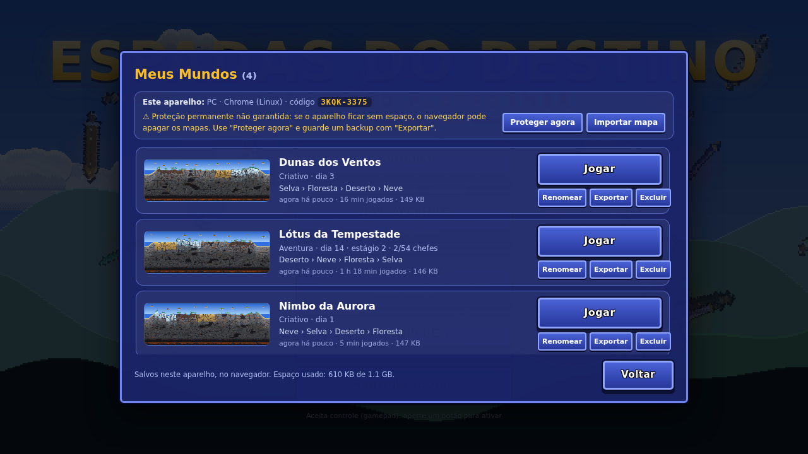 |

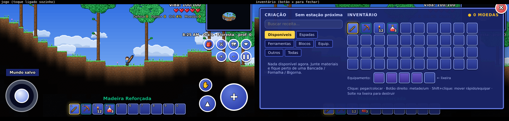

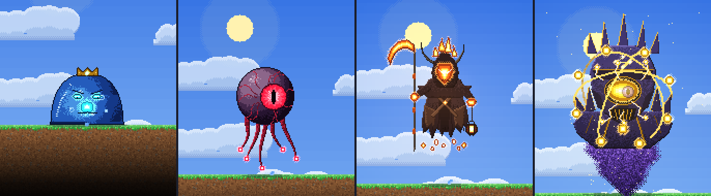

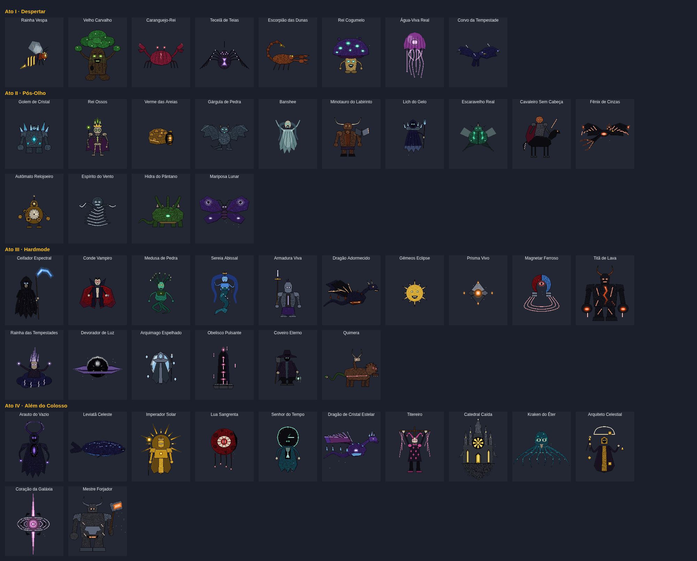

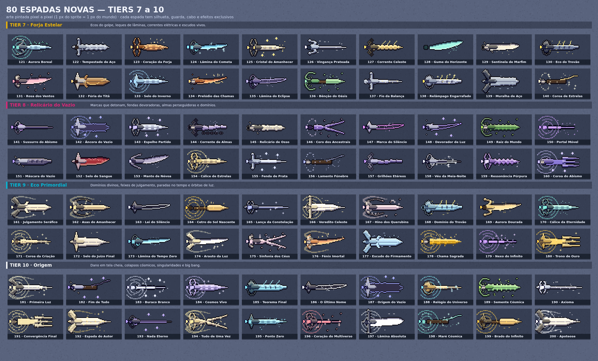

---

## Controles

| Tecla / mouse | Ação |
|---|---|
| `A` `D` / `←` `→` | Mover |
| `Espaço` `W` `↑` | Pular · nadar para cima |
| **Botão esquerdo (segurar)** | Atacar (arco de ataque na direção do cursor) · minerar · colocar bloco · usar item |
| Botão direito | Abrir baú · abrir/fechar porta · falar com NPC |
| `1`–`0` / roda do mouse | Selecionar item da barra |
| `E` / `Tab` | Inventário + criação (fique perto de Bancada, Fornalha, Bigorna…) |
| `B` | **Arsenal** (modo Criativo) · **Catálogo das 120 espadas** (modo Aventura) |
| `M` | Mapa do mundo · `Q` poção de cura · `+` `-` zoom · `F3` debug · `Esc` pausar/fechar |

### Toque (celular/tablet)

Liga **sozinho** em telas de toque (e pode ser forçado em *Pausa → Controles de toque: automático / ligado / desligado*, o que também permite testar no computador).

| Controle | Ação |
|---|---|
| Direcional (esquerda) | Mover · empurrar para cima = pular |
| Botão **+** grande (direita) | Segurar: atacar · minerar · colocar bloco · usar item. **Arrastar** o dedo a partir dele mira (direção e distância, como o analógico direito do controle) |
| ▲ · ✋ | Pular · interagir (baú, porta ou NPC mais próximo) |
| Botões redondos sob o minimapa | Inventário · arsenal/catálogo · mapa · cura rápida · zoom + / − · pausa |
| Tocar num espaço da barra de itens | Seleciona o item |
| Inventário e Arsenal | Tocar pega o item e tocar noutro espaço solta; no Arsenal, tocar numa espada a pega, e as abas e os botões de inimigos/chefes respondem ao toque |
| ✕ (com um painel aberto) | Fecha o painel |

Multitoque funciona (andar e atacar ao mesmo tempo). O código está em `src/15g_touch.js`.

### Mundos: criar, salvar e continuar

- **Sem campo de semente.** *Nova Aventura* e *Modo Criativo* criam um mundo **novo e único**: a semente é sorteada na hora (`crypto.getRandomValues`) e **nunca se repete** — o jogo guarda todas as sementes já usadas, inclusive as de mundos que você excluiu.
- **Nenhum mundo parece o outro.** Cada mundo sorteia a **ordem e a largura dos biomas** (deserto, floresta, selva e neve: 24 ordens possíveis), o tamanho dos oceanos das bordas, o ponto de partida (sempre dentro da floresta, para haver árvores logo no começo) e o estilo do relevo (montanhosidade de cada bioma, dunas, cavernas, lagos e ilhas flutuantes). Ao criar um mundo, o jogo escolhe entre 32 candidatos o de mapa de biomas **menos parecido** com os que você já tem — e, enquanto existir uma ordem de biomas inédita, usa uma: **os 24 primeiros mundos têm 24 ordens diferentes**.
- **Vários mundos salvos.** *Meus Mundos* lista cada mundo com a miniatura do mapa, nome, modo, dia/estágio/chefes, ordem dos biomas e tempo de jogo; *Continuar*, no topo do menu, abre o último. Dá para **renomear** e **excluir** (o 1º clique pede confirmação). Cada mundo recebe um nome automático (ex.: "Aurora do Aço"), único na sua lista.
- **Salvamento automático**: a cada minuto, logo depois de criar o mundo, ao esconder a aba e em *Salvar e voltar ao menu*; *Salvar mundo*, no menu de pausa, salva na hora. A "foto" do jogo leva ~4 ms (sem engasgo) e a gravação segue em segundo plano.
- **Onde fica**: no IndexedDB do navegador (banco `espadas120`, ~150 KB por mundo), então cabem centenas de mundos. Os mundos ficam **neste aparelho, no navegador de quem joga** (por endereço): em outro navegador, aparelho ou endereço a lista começa vazia. Sem IndexedDB (ex.: `<iframe sandbox>`), os mundos duram só enquanto a página estiver aberta, com aviso na tela. Se o espaço acabar, o jogo avisa — nada é perdido em silêncio.
- **Este aparelho (e por que não o IP).** *Meus Mundos* mostra o aparelho (ex.: `PC · Chrome (Windows)`, `Celular · Safari (iOS)`) e um **código aleatório** (`K7QF-3M9D`), gerado uma vez e guardado no próprio aparelho; cada mundo lembra de que aparelho veio. **O IP não é usado**: um site não consegue ler o IP local (os navegadores escondem), o IP público muda ao trocar de rede (Wi‑Fi ↔ 4G) e é o mesmo para todos na mesma casa ou operadora — se o mapa dependesse dele, "sumiria" ao trocar de rede. Os mapas já estão no aparelho porque o armazenamento do navegador é por aparelho; o código só diz de onde um mapa veio.
- **Proteção permanente.** Depois do primeiro salvamento o jogo pede ao navegador armazenamento *persistente* (`navigator.storage.persist()`), para ele **não apagar os mapas sozinho** quando faltar espaço. O Chrome decide em silêncio; no Firefox o pedido só acontece pelo botão **Proteger agora** (ele abre um aviso próprio); sem a API, a tela diz isso. O estado aparece em *Meus Mundos* (✔ ativa / ⚠ não garantida).
- **Backup e levar o mapa para outro aparelho.** *Exportar* (em cada mundo) baixa um arquivo `espadas-<nome>-<data>-<hora>.json` com o mundo inteiro (~220 KB), guardado onde você quiser; *Importar mapa* aceita vários arquivos de uma vez e funciona em qualquer aparelho, também no modo sem IndexedDB. O arquivo tem **verificação de integridade (CRC‑32)** e, ao importar, **tudo é validado** (itens que existem, camadas do tamanho certo, valores na faixa, miniatura só PNG) e o mundo é reconstruído só com campos permitidos — arquivo corrompido ou adulterado é recusado com o motivo, nunca quebra o jogo nem executa código. Regras: mundo novo entra na lista (nome único, semente registrada: **nunca é sorteada de novo**); o **mesmo mundo** (mesma semente e data de criação) só é atualizado se o arquivo for **mais novo e tiver mais tempo de jogo** — se os dois aparelhos evoluíram separados, nada é trocado e a tela explica; o progresso maior nunca é perdido em silêncio.
- **Save antigo**: quem tinha o save de um slot só (formato antigo, em `localStorage`) tem o mundo importado automaticamente para *Meus Mundos*, uma única vez.
- Nos testes, `window.__nextSeed = N` força a semente do próximo mundo criado pelos botões; a interface não oferece como escolher semente.

### Jogar online / publicar

- **GitHub Pages (este repositório):** já ativado — o jogo está em `https://jk-jhon1.github.io/101spas/`. Para ativar numa cópia/fork: *Settings → Pages → Build and deployment → Source: Deploy from a branch → Branch `main`, pasta `/ (root)` → Save* (em 1–2 minutos o jogo fica em `https://SEU_USUARIO.github.io/NOME_DO_REPO/`). O `index.html` já está na raiz e o arquivo `.nojekyll` dispensa o processamento do Jekyll.
- **Local:** `node serve.js` (ou `npm run serve`) abre o jogo em `http://localhost:8080/` (servido por http, o salvamento e o controle funcionam em qualquer navegador).
- **Outras hospedagens:** o jogo é um único `index.html`; qualquer hospedagem estática serve — por exemplo **itch.io** (*Kind of project: HTML*, envie um `.zip` com o `index.html` na raiz e marque *"This file will be played in the browser"*) ou **Netlify Drop** (`netlify.com/drop`, arraste a pasta; crie uma conta gratuita para o site não expirar).

### Controle (gamepad) — mira analógica

O GDD manda orientar o arco pelo "cursor do mouse/**analógico**", então o jogo também roda com controle
(layout padrão Xbox/PlayStation; o navegador só enxerga o controle depois do primeiro botão apertado).

| Botão | Ação |
|---|---|
| Analógico esquerdo / direcional ◀ ▶ | Mover |
| `A` | Pular · nadar para cima |
| **Analógico direito** | **Mira analógica**: o arco da espada aponta para onde o analógico aponta; a inclinação define a distância do alvo (ferramentas ficam sempre dentro do alcance de mineração). Uma cruz mostra o alvo |
| `RT` ou `X` (segurar) | Atacar · minerar · colocar bloco · usar item. Sem mira no analógico direito: usa o analógico esquerdo (ex.: ↓ para cavar para baixo) ou o lado para onde o jogador olha |
| `B` | Interagir com o baú / porta / NPC mais próximo (sem precisar mirar) |
| `LB` `RB` | Item anterior / próximo da barra |
| `LT` | Poção de cura rápida |
| `Y` · direcional ▲ · direcional ▼ ou `Select` | Inventário e criação · catálogo/arsenal · mapa |
| `L3` `R3` | Zoom − / + |
| `Start` | Pausar / fechar painéis |
| **Menus** | Direcional ou analógico ▲▼ escolhe, `A` confirma |
| **Painéis** (inventário, criação, catálogo, NPC) | Analógico esquerdo move um cursor virtual · `A` clica · `X` botão direito · `RB` Shift+clique · analógico direito rola a lista · `B` fecha |

Mouse e controle podem se alternar: mexer o mouse devolve a mira a ele. Dentro de um `<iframe>` sem `allow="gamepad"`
o navegador bloqueia a API (o jogo detecta isso e simplesmente ignora o controle) — abra o `index.html` direto no navegador.

**Modo Aventura:** comece com a espada 001 e uma picareta de cobre; minere, crie, derrote chefes e forje as 120 espadas.
**Modo Criativo:** Arsenal com todas as espadas/itens, Boneco de Treino (não morre e mostra o dano de cada golpe), invocação de qualquer
inimigo/chefe (inclusive variantes elementais), controle de hora, teleporte, estágio do mundo, invencibilidade etc.

### 50 chefes novos
Além dos 4 chefes da progressão, há **50 chefes novos** em 4 atos (8 + 14 + 16 + 12), cada um com **visual próprio** e **uma mecânica única** (tabela completa, com vida, dano, receita e espada: [`docs/chefes_novos.md`](docs/chefes_novos.md)).
- **Como enfrentar:** no *Criativo*, Arsenal → *Inimigos & Chefes*. No modo *Aventura*, forje o **Sigilo** do chefe (receita na estação do ato: Bancada, Bigorna, Bigorna Avançada ou Forja Celeste) e use-o; alguns pedem local ou hora (selva, deserto, oceano, noite, cavernas, Inferno…) e cada ato só abre depois do chefe do ato anterior (Ato II depois do Olho, Ato III depois do Guardião, Ato IV depois do Colosso).
- **Mecânicas únicas, em exemplos:** a *Rainha Vespa* cospe poças de mel que travam seus passos; o *Caranguejo-Rei* só fica vulnerável com as garras abertas; o *Rei Ossos* ressurge uma vez; a *Medusa* petrifica quem a olha de frente; a *Armadura Viva* só leva dano de verdade pelas costas; o *Dragão Adormecido* acorda a cada golpe que leva; o *Arauto do Vazio* inverte a gravidade; o *Titereiro* inverte seus comandos; e o *Mestre Forjador* aprende a resistir à espada que você mais usa.
- **Recompensas:** moedas, materiais do ato, poções, às vezes um Cristal de Vida e **uma espada garantida** de cada chefe (as espadas continuam podendo ser forjadas).
- **Efeitos novos no jogador** (sempre temporários, somem ao morrer): lentidão, confusão (controles invertidos), atordoamento, silêncio (sem atacar), gravidade invertida, flutuar, maldição (sem cura), sangramento acumulável e tempo lento.

### Progressão
1. **Tier 1** — madeira, cobre, ferro → Bancada → Fornalha → Bigorna. Picareta ganha poder para novos minérios.
2. **Tier 2** — platina, meteorito (ilhas do céu e crateras), Brasita do Inferno, gemas, presas, ferrões. Chefes: **Rei Slime**, **Olho Colossal** (à noite).
3. **Tier 3/4 (Hardmode)** — **Guardião do Abismo** (invocado no Inferno com o Boneco Infernal) inicia o Hardmode: surgem
   Cobalto/Paládio/Mithril/Orichalcum/Titânio/Adamantita; inimigos elementais dropam **Essências**. Bigorna Avançada (Mithril/Orichalcum).
4. **Tier 5/6** — Fragmentos Celestes → Forja Celeste. **Colosso Estelar** (chefe final) dropa o **Núcleo Mítico** para o Tier 6.

Estações: Bancada → Fornalha → Bigorna → Bigorna Avançada → Forja Celeste. NPCs (Guia, Mercador, Enfermeira, Armeiro) moram em
casas válidas (sala fechada com paredes de fundo, luz, mesa/bancada, cadeira e porta).

---

## Mapeamento GDD → implementação

| Seção do GDD | Onde / como foi feito |
|---|---|
| Grid de tiles **16×16**, blocos destrutíveis/colocáveis | `TS = 16`; camadas `Uint8Array` de tile/parede/líquido (`02_world.js`, `12_player.js`) |
| Mundo procedural **assíncrono** | `genWorld()` é um *generator* (`03_worldgen.js`) consumido em fatias de ~14 ms por frame, com barra de progresso. 1400×480 tiles (~0,8 s); biomas horizontais (oceano/deserto/floresta/selva/neve) **em ordem e largura sorteadas por mundo** (`makeLayout`) + camadas verticais (céu, superfície, cavernas, profundas, Inferno) |
| **Iluminação dinâmica** por propagação de opacidade | `04_light.js`: luz RGB por célula, decaimento pela opacidade do tile de origem, 2×4 varreduras, fontes dinâmicas (projéteis, tochas, lava), ciclo dia/noite. Composição multiplicativa preservando o céu (`16_main.js`) |
| **Simulação de fluidos / gravidade** | Autômato celular de água e lava (lava+água = obsidiana), areia com gravidade, plantas e objetos sem apoio quebram (`02_world.js`) |
| Pilares: biomas verticais · minérios progressivos · crafting encadeado · abrigo/NPCs · combate rápido com curva de poder | Camadas do mundo; picaretas de poder 1–9 × dureza dos minérios; 5 estações; `15b_npc.js`; DPS base médio por tier: **17 → 37 → 62 → 88 → 156 → 245** |
| **Melee**: arco θ0→θfinal em torno do ombro, direção (Cursor − Jogador), cursor do **mouse/analógico** | `09b_swing.js`: ombro como pivô, arco de ~143° centrado na mira, sentido alternado a cada golpe; Thrust/Beam usam a mesma direção. Mira por mouse ou por analógico direito (`15d_gamepad.js` converte a inclinação do analógico em um "cursor" no mundo) |
| **Knockback** `F = normalize(Alvo−Jogador) × KB` com amortecimento por massa | `hitEnemy()` em `09_combat.js` (`F = KB·58 / (0,5+0,5·massa) · (1−resistência)`) |
| **I-frames independentes** (jogador × inimigos) | Jogador: `P.inv_` dinâmico (0,55–1,1 s conforme o dano). Inimigos: imunidade **por fonte** (cada golpe/projétil guarda sua janela) — evita hits duplicados em colisões sobrepostas |
| `DanoFinal = (DanoBase + ModAcessórios) × (1+CritMult) × ModResistência` | `hitEnemy()`: acessórios somam dano plano; crítico `×(1+CritMult)`; resistência `60/(60+defesa)` |
| Projéteis herdam **100% da direção do arco no ápice** | `shoot()` em `10_fx.js` dispara em `inst.aim` a partir de `inst.tip` no meio do arco |
| **Inventário**: slots, IDs únicos, stack ≤ 999, metadados de raridade | 40 slots + 4 de equipamento; `STACK_MAX = 999`; `item.tier` define cor de borda/nome/tooltip (`TIERS` em `01_data.js`) |
| **Tiers e cores** (T6 índigo/dourado) | `TIERS`: `#10b981 #0284c7 #7c3aed #d97706 #dc2626 #4f46e5` + extras `#eab308 #db2777 #06b6d4 #f8fafc` (T7–T10) |
| **Schema `SwordItemSO`** | `11_swords.js`: `swordID, swordName, tierLevel, baseDamage, attackSpeed, knockbackForce, critChance, projectilePrefab, attackType (ArcSwing/Thrust/Orbital/Beam), passiveEffects[]`, métodos `OnSwing(combat, dir)` e `OnHitEnemy(enemy, info)` |
| **Comportamentos de projétil**: Ballistic, Linear perfurante, Homing, Static/Área | `spawnProj()` (`09_combat.js`): `ballistic` (gravidade), `linear` (`pierce = X`), `homing` (`Vnew = Vcurr + Lerp(Alvo−Pos, steer)`), `static` + `custom` (órbita, onda de chão, feixe, buraco negro…) |
| **Catálogo de 200 espadas** | `11_swords.js` (001–120) + `11b_swords_x.js` (121–200) + bibliotecas de efeitos `10_fx.js` e `FX2` (hooks `swing/onSwing/onApex/mod/onHit/onProjHit/onKill/tick/atkMult/stats/init`) |
| **Arte das 80 espadas novas** | `06b_swordart.js`: pintura pixel a pixel por receita (`look.art2`): 27 famílias de lâmina + 21 guardas + 7 cabos + 4 pomos + 20 extras (anéis, asas, glifos, runas, rachaduras, estrelas, brasas, gelo, correntes…) — nenhuma receita repete a combinação de outra |

### Interpretações assumidas (onde o GDD é ambíguo)
- **Ápice** = metade do arco, quando a lâmina aponta para o cursor; é aí que saem os projéteis e efeitos.
- **005 Vidro Vulcânico**: 5% de chance de quebrar a cada acerto (devolve metade dos materiais; nunca quebra no Criativo).
- **056 Sacrifício**: nunca reduz a vida abaixo de 1 HP. **086 Tempo Congelado**: tem 35% de crítico para o efeito ser viável.
- **096 Quantum**: "costas" = o inimigo olha para o lado oposto ao jogador (os inimigos terrestres demoram ~0,4 s para virar).
- **055 Fóton**: golpes contínuos sem recuperação (a duração do arco ocupa todo o ciclo).

---

## Estrutura do projeto

```
index.html            ← JOGO (arquivo único gerado; é o que você abre)
build.js              ← concatena src/ em index.html:  node build.js
serve.js              ← servidor local (node serve.js → http://localhost:8080/)
package.json          ← scripts npm; única dependência: Playwright (só para os testes de navegador)
src/
  00_util.js            matemática, RNG, ruído Perlin, cores
  01_data.js            TIERS, tiles, paredes, itens, receitas
  02_world.js           mundo, fluidos, areia, apoio de objetos
  03_worldgen.js        geração procedural assíncrona (generator)
  04_light.js           iluminação por propagação de opacidade, céu
  05_gfx.js / 06_icons  sprites 16×16 procedurais (bordas lascadas, folhas, galhos), ícones 32×32 em pixel-art, sprites das espadas
  05b_pixel.js          pixelizador (alfa binário + contorno + sombreamento) usado por inimigos, jogador, NPCs e ícones; bonecos humanos de frente (jogador, NPCs, zumbis); corações da HUD
  05c_canopy.js         copas das árvores desenhadas por vizinhança: silhueta redonda com contorno escuro, folhas pontiagudas sobrepostas e luz de cima à esquerda (só o desenho; a geração do mundo não muda)
  05d_bosspaint.js      ferramentas de pintura pixel a pixel dos chefes: formas (polígono, elipse, traço, curva), preenchimento com luz de cima à esquerda, borda, brilho com halo pontilhado e marcação dos pixels que emitem luz
  05e_bossart.js        sprites dos 4 chefes (corpo escuro + brilho de uma cor), quadros de animação em cache e peças móveis (lanterna, íris, anéis, orbes)
  05f_bxart.js          base da arte dos 50 chefes novos: rampas de cor, ajudas de pintura (formas, espelho, brilho com halo, contorno), cache de quadros e variantes
  06b_swordart.js       arte pixel a pixel das 80 espadas novas: silhuetas (reta, katana, foice, tridente, garra, chama, cristal…), guardas, cabos, pomos, gemas, runas, contorno e pixels emissivos
  11b_swords_x.js       as 80 espadas dos Tiers 7–10: dados, receitas e os 25 efeitos novos (FX2)
  05g..05j_bxart*.js    um pintor por chefe novo (Ato I a IV)
  14b_draw_bx.js        desenho dos chefes novos e dos lacaios (camadas móveis, sombra, tinta de dano)
  07_sky.js             céu em baixa resolução: faixas, sol/lua com halo, estrelas, nuvens de pixels, colinas em colunas
  08_phys.js            física AABB, partículas, drops · 08b_audio.js: SFX (WebAudio)
  09_combat.js          dano, status, projéteis, explosões, feixes
  09b_swing.js          arco de ataque, ápice, colisão da lâmina
  10_fx.js              biblioteca de efeitos de espadas
  11_swords.js          as 120 espadas originais (schema SwordItemSO)
  12_player.js          jogador, inventário, crafting, mineração, blocos
  13_enemies.js         inimigos, IA, spawn, drops · 13b_bosses.js: 4 chefes
  13c_bossx.js          motor dos 50 chefes novos: registro (bx), laço de IA com golpes em geradores (yield), zonas de perigo, raios com aviso, lacaios, debuffs do jogador, loot e vitória
  13d..13g_bx_*.js      os 50 chefes novos por ato (dados, mecânica única e golpes de cada um)
  14_draw_enemies.js    sprites dos inimigos; `BOSSDRAW` monta cada chefe com as camadas de 05e e soma o brilho no passe aditivo
  15_ui.js / 15b_npc.js   HUD, inventário, arsenal, NPCs
  15c_save.js           biblioteca de mundos: IndexedDB, autosave, miniaturas, migração do save antigo
  15d_gamepad.js        suporte a controle: mira analógica, menus, cursor virtual nos painéis
  15e_worlds.js         tela "Meus Mundos", menu do título, criar / abrir / sair
  15f_transfer.js       este aparelho (código), proteção do armazenamento, mapa em arquivo (exportar / importar + validação)
  15g_touch.js          controles de toque: direcional virtual, botão de ação com mira por arrasto, pulo, interagir, painéis
  16_main.js            loop, câmera, renderização em camadas (cena em baixa resolução + zoom inteiro), input
docs/                 catálogo das 200 espadas (md/csv) e capturas de tela (img/)
dev/                  scripts de teste (Node + Playwright) · `art_sheet.js` gera a folha de contato das 80 espadas novas
```

### Portar para Unity / Godot
A arquitetura segue o GDD e foi escrita para ser portada. O schema JS equivale a um `ScriptableObject`:

```csharp
[CreateAssetMenu] public class SwordItemSO : ScriptableObject {
  public int swordID; public string swordName; [Range(1,6)] public int tierLevel;
  public float baseDamage, attackSpeed, knockbackForce, critChance;
  public GameObject projectilePrefab; public AttackType attackType;   // ArcSwing, Thrust, Orbital, Beam
  public List<PassiveEffect> passiveEffects;
  public virtual void OnSwing(CombatController c, Vector2 dir) { foreach (var e in passiveEffects) e.OnSwing(c, dir); }
  public virtual void OnHitEnemy(Enemy e, HitInfo i)          { foreach (var p in passiveEffects) p.OnHit(e, i); }
}
```
Os hooks de `10_fx.js` (`swing`, `onApex`, `mod`, `onHit`, `onKill`, `tick`) correspondem 1:1 a métodos virtuais de `PassiveEffect`.
Os dados (tiles, itens, receitas, 120 espadas) estão em tabelas simples, fáceis de exportar para JSON/CSV (`docs/*.csv`).

---

## Testes realizados (automatizados, Chromium headless)
> **Como rodar:** `node dev/validate.js` (catálogo; também regenera `docs/catalogo_*`), `node dev/reach.js`, `node dev/seeds.js`, `node dev/layouts.js` (variedade dos mundos) e `node dev/transfer.js` (mapa em arquivo, validação, aparelho, proteção) precisam só do Node (`npm test` roda os cinco). Os testes de navegador usam Playwright: `npm install && npx playwright install chromium`, depois `node dev/test_swords.js` etc. (`npm run test:browser` roda os doze com veredito: mundos salvos, aparelho/arquivos, controle, toque, aparência, arsenal, inimigos, chefes, chefes novos (luta e arte), soak e espadas). `node dev/http_check.js [url]` confere uma URL do jogo (local ou publicada) de ponta a ponta: carrega, salva, recarrega e continua. Os scripts localizam o `index.html` pelo próprio caminho e dividem utilitários em `dev/lib.js`; capturas temporárias vão para `dev/*.png` (ignoradas pelo git). Depois de editar `src/`, recompile com `node build.js`.

- **Catálogo**: 200 espadas, 20 por tier (10 tiers), faixas de dano por tier, receitas válidas (`node dev/validate.js`).
- **Progressão**: todo item é obtível e as 120 espadas são craftáveis a partir de fontes reais do mundo (`node dev/reach.js`); gerador testado em 8 sementes (`node dev/seeds.js`).
- **Variedade dos mundos** (`dev/layouts.js`): 20.000 layouts (as 24 ordens de bioma equilibradas, oceanos de 90 a 220 colunas, spawn sempre na floresta, larguras mínimas), o sorteio de sementes (nunca repete; os 24 primeiros mundos têm 24 ordens diferentes) e 14 mundos completos comparados entre si — biomas, relevo, terreno bloco a bloco — mais o determinismo (mesma semente = mesmo mundo).
- **Mundos salvos** (`dev/test_worlds.js`, 60 verificações): 6 mundos criados pelos botões (sementes, nomes, ordens de bioma e miniaturas diferentes), reabrir depois de recarregar a página, **fidelidade do save bloco a bloco** (blocos, paredes, líquidos, baús, inventário, chefes, Hardmode…), autosave, renomear/excluir, teletransporte do Arsenal para o bioma certo, semente excluída que nunca volta, migração do save antigo (inclusive sem IndexedDB: o save antigo nunca é apagado se o mundo não puder ser gravado de verdade), ambiente sem IndexedDB, cota estourada e mundo corrompido.
- **Mapa em arquivo, aparelho e proteção** — sem navegador (`dev/transfer.js`, 73 verificações): CRC‑32 (igual ao `zlib`), ida e volta byte a byte, **52 adulterações com o CRC refeito** (item/bloco/bioma/NPC inexistente, camadas truncadas, valores fora da faixa, `__proto__`, quantidades absurdas…) todas recusadas sem exceção, fuzz de 400 arquivos corrompidos, regras de importação (novo / atualiza / ignora / divergente), código do aparelho, 12 *user‑agents* e a API de proteção (concedida, negada, com erro, ausente). No navegador (`dev/test_device.js`, 69 verificações): vários "aparelhos" separados — exportar de um e importar em outro (o que fica guardado é **idêntico**, camada por camada), levar o progresso de volta, dois aparelhos que evoluíram separados, proteção (Chrome, Firefox, sem a API), celular (iPhone, sem rolagem horizontal), sem IndexedDB e arquivos maliciosos (injeção de código no nome, na miniatura e no rótulo: nada é executado).
- **Efeitos das 80 espadas novas** (`dev/test_swords_x.js`): executa **todos os hooks** de cada uma (init/swing/onApex/mod/onHit/onProjHit/onKill/tick/atkMult/stats) num motor de mentira e falha se alguma lançar exceção ou não chamar nada.
- **120 espadas originais em combate** (`dev/test_swords.js`): cada uma ataca bonecos/inimigos por ~4,5 s — sem exceções, todas causam dano, status esperados observados (sangramento, veneno, gelo, atordoamento, tempo parado, podridão, pânico, cegueira…).
- **Todos os inimigos, variantes elementais e os 4 chefes** (`dev/test_enemies.js`) e **~45.000 passos** de simulação com spawn natural em 14 cenários, todas as camadas e estágios (`dev/soak.js`): zero erros.
- **Aparência e copas** (`dev/test_skin.js`, 20 verificações): interface azul única (o menu de Pausa não tem botão para trocar, mesmo com a escolha antiga "escura" guardada no aparelho), silhueta, contorno e cache das copas das árvores, lote de desenho, e a ausência do retângulo "DPS · Total" (removido da tela).
- **Sprites dos 4 chefes** (`dev/test_bosses.js`, 62 verificações): corpo escuro com brilho de uma cor própria para cada chefe, paleta curta, fases, espelhamento exato do Guardião, íris que acompanha o jogador, clarão de dano e tinta de status, sombra no chão dos chefes voadores, cache de quadros limitado, tempo de geração e caixas de colisão intactas.
- **50 chefes novos — luta** (`dev/test_bx.js`, 501 verificações): cada chefe é invocado, luta nas 3 fases contra um jogador invencível, executa **todos** os seus golpes até o fim, é desenhado em todas as variantes, morre, solta o loot e a espada e some junto com lacaios, zonas e raios; sem exceções.
- **50 chefes novos — arte, sigilos e invocação** (`dev/test_bx_art.js`, 508 verificações): silhuetas todas diferentes, corpo escuro com brilho emissivo, paleta curta, caixa de colisão dentro do desenho, nomes/mecânicas/espadas únicos, estágio e condição de cada sigilo (aceita no lugar certo, recusa no errado), uso do item no modo Aventura e tempo de geração dos quadros.
- Entrada real de teclado/mouse, crafting pela interface, NPC/moradia, salvar/carregar, fluidos/areia, capturas de tela de biomas e de efeitos.
- **Toque** (`dev/test_touch.js`, 43 verificações, toque emulado no Chromium com `Input.dispatchTouchEvent`): liga/desliga pelo menu de pausa, liga sozinho no "celular", direcional (direita/esquerda/pulo), botão de pulo, botão de ação com mira por arrasto (ângulo e distância), multitoque (andar + atacar), painéis e botão fechar, zoom inteiro, cura rápida e interagir com baú.
- **Controle** (`dev/test_gamepad.js`, gamepad simulado, 80 verificações): menus, andar/pular, ângulo real do arco para ↑ → ← ↖ ↘, distância pela inclinação, acerto de inimigo só na direção da mira, minerar/colocar bloco, interagir, mundos salvos (Continuar, Meus Mundos, Jogar, Y exclui), cursor virtual (hover, clique, craft, comprar do NPC), pausa/guia, volta do mouse e API bloqueada.

## Limitações conhecidas
- Sem música (apenas efeitos sonoros sintetizados); sem multiplayer. O suporte a controle foi validado com gamepad simulado e o de toque com eventos de toque emulados (não com hardware real); o som só liga após o primeiro clique/tecla/botão, regra dos navegadores.
- Mundo de tamanho fixo (1400×480). Os mundos salvos ficam no IndexedDB do navegador (não funciona dentro de iframes *sandbox*: lá duram só a sessão; abra o HTML direto no navegador ou por http) e não são sincronizados automaticamente entre aparelhos: use *Exportar* / *Importar mapa* (ver acima). Os navegadores podem apagar dados de sites em casos extremos — o Safari (iPhone, iPad e Mac), por exemplo, limpa os de sites que ficam cerca de uma semana sem uso —, então guarde um backup com *Exportar* dos mapas que importam. Painéis de pré-visualização (iframe *sandbox*) bloqueiam o armazenamento e também o download.
- Balanceamento de chefes/drops validado por simulação, mas não por playtest humano extenso — ajuste os números em `13_enemies.js` / `11_swords.js` se quiser.
- As 40 espadas ★ são interpretações minhas do GDD; trocar pelas originais é simples (ver acima).
